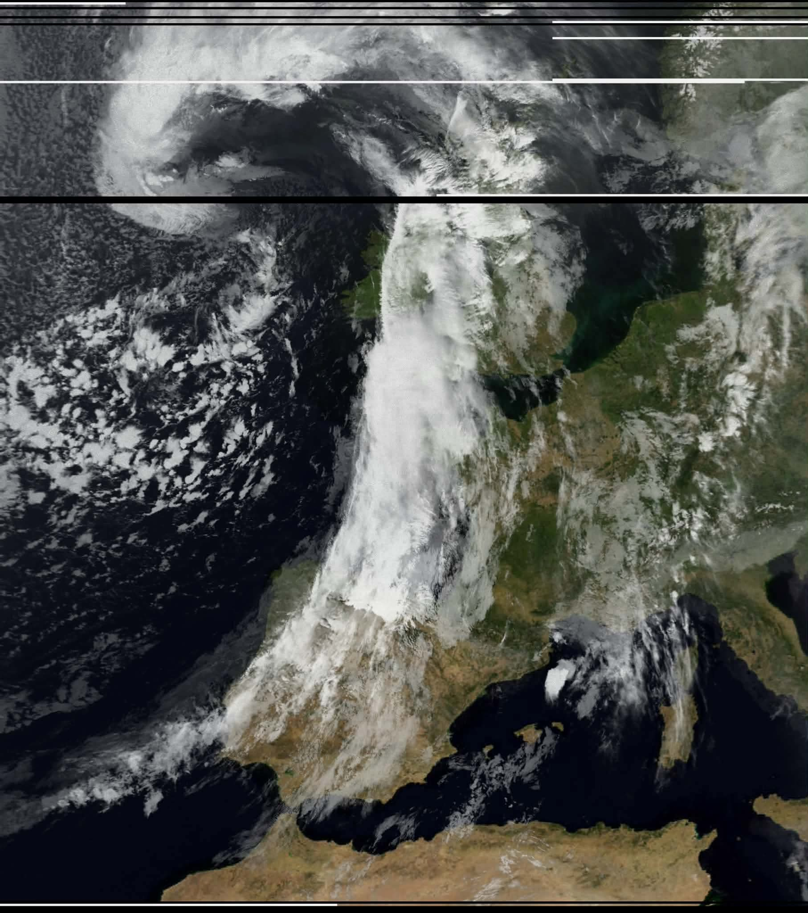
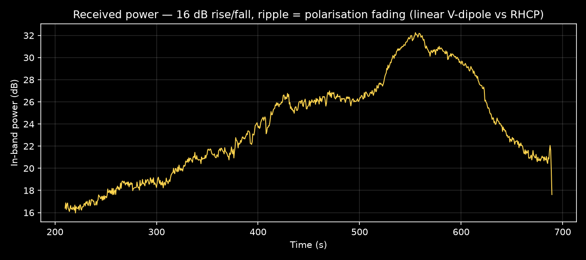
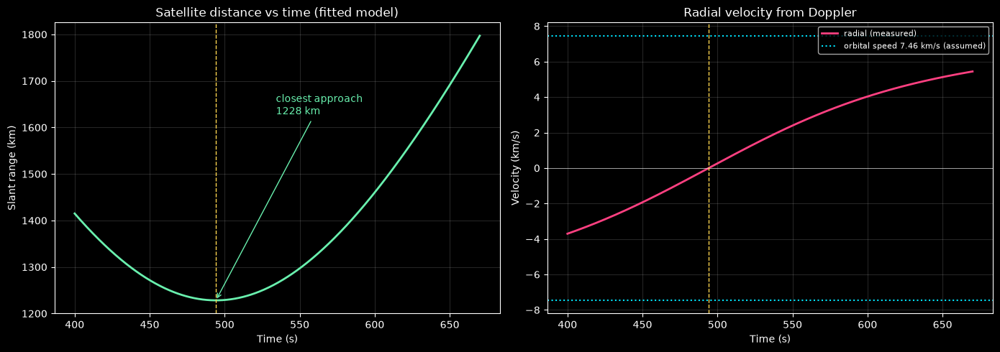
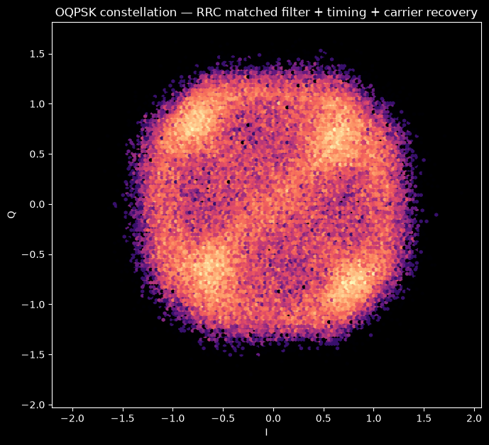

# Receiving-Weather-Satellite-Images
## Background 
It's 2026 and the NOAA APT satellites have already all been decommissioned. What's left on 137 MHz is the Russian Meteor-M series, running well and still streaming using Offset Quadrature Phase Shift Keying **(OQPSK)**.

In this post we'll try to receive images from it and decode them using SatDump.

## BOM
| Item | Notes | ~Cost |
|---|---|---|
| RTL-SDR Blog V3 | V3 or V4. Needs TCXO + bias-tee | £40 |
| V-dipole | Two legs ~53 cm, at 120° | £15 |
| *Optional:* SAWbird+ NOAA LNA | Filtered, at the antenna | £35 |
| SatDump | Software for recording and decoding | free |
| N2YO | Website for tracking | free |
 
This capture was made **without** the LNA.
 

## Brief Guide
 
1. Go to N2YO, set your location and find the right satellite (Satellites on Orbit → CIS (Former USSR) → Meteor M2-3 or M2-4).
 Look for a pass with a high **max elevation** - anything under 30° isn't worth the effort, 60–70° is what you want.
 
2. Connect the RTL-SDR to the antenna and plug it into the PC. You'll need to install drivers the first time — use the instructions on the RTL-SDR website:
https://www.rtl-sdr.com/rtl-sdr-quick-start-guide/

3. The legs of the antenna should be around 54 cm long with a 120° angle between them (a wide V).
Mount it horizontally, with the V facing north–south.
**Place it away from tall trees and buildings!**
 
4. Run the recorder in SatDump at 137.9 MHz. Start it a couple of minutes before the pass and don't touch anything.
 
At first it's just going to be noise, but the closer the satellite gets, the stronger the signal.
## Results - Photos

<p align="center">
*29/09/2026, 21:50 BST, no LNA. Image is taken with IR sensors, and colour-corrected*
</p>

## Results - Data analysis (Python)
```python
import numpy as np
from scipy.io import wavfile
 
fs, raw = wavfile.read("Data_29092026.wav")
iq = (raw[:,0].astype(np.float32) + 1j*raw[:,1].astype(np.float32)) / 32768.0
```
 
### Power Profile
 
```python
nfft, ncols = 2048, 800
step = max(nfft, len(sig)//ncols); win = np.hanning(nfft)
cols = np.arange(0, len(sig)-nfft, step)
W = np.empty((nfft, len(cols)))
for k, i in enumerate(cols):
    W[:,k] = 20*np.log10(np.abs(np.fft.fftshift(np.fft.fft(sig[i:i+nfft]*win))) + 1e-9)
 
fr  = np.fft.fftshift(np.fft.fftfreq(nfft, 1/fs))
pwr = 10*np.log10(np.nansum(10**(W[np.abs(fr) < 60e3]/10), 0))
```
 

<p align="center">
*16 dB swing across the pass as the satellite climbs and descends*
 </p>
### Distance & Speed
 
Tracking the carrier frequency with a Costas loop gives the Doppler shift and from that the radial velocity:
 
```python
def costas_qpsk(x, bw=0.01, zeta=0.707):
    th = bw; d = 1 + 2*zeta*th + th*th
    a, b = 4*zeta*th/d, 4*th*th/d
    ph = fq = 0.0
    y = np.empty(len(x), complex); frq = np.empty(len(x))
    for i, v in enumerate(x):
        o = v*np.exp(-1j*ph)
        e = np.clip(np.sign(o.real)*o.imag - np.sign(o.imag)*o.real, -1, 1)
        fq += b*e
        ph += fq + a*e
        y[i], frq[i] = o, fq
    return y, frq
 
v_radial = -(f_doppler / 137.9e6) * 299792458.0
```
 

<p align="center">
*The distance curve comes from fitting an orbital model to that Doppler, and it lands about 18% high (1228 km vs ~1040 km from N2YO's 52° max elevation).
</p> 
### OQPSK
 
```python
# RRC matched filter + timing recovery + carrier recovery
x = front_end(seg, fs, FOFF)        # de-rotate, resample to 2 sps, RRC, de-stagger
sym, _ = gardner(x, bw=0.0003)      # symbol timing
rec, _ = costas_qpsk(sym, bw=0.002) # carrier phase
 
plt.hexbin(rec.real, rec.imag, gridsize=140, bins='log', cmap='magma')
```


<p align="center">
*Four distinct phase states, each carrying 2 bits*
</p>
